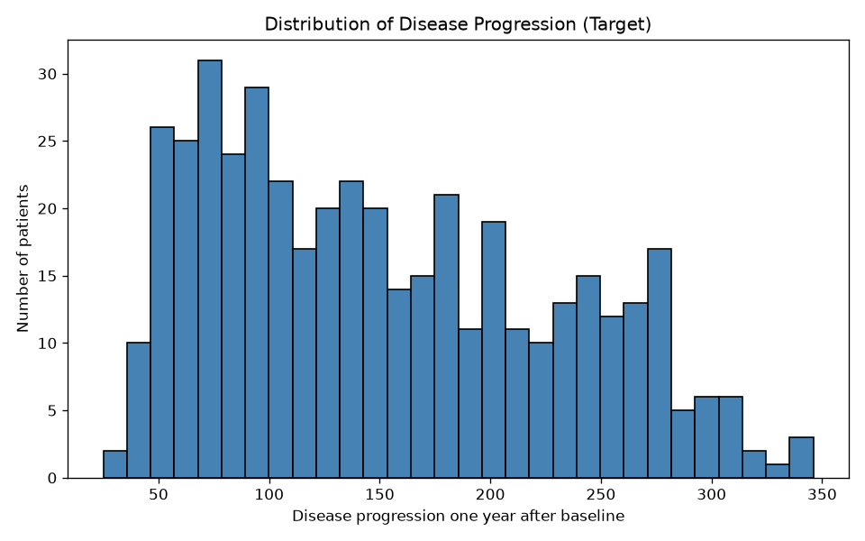
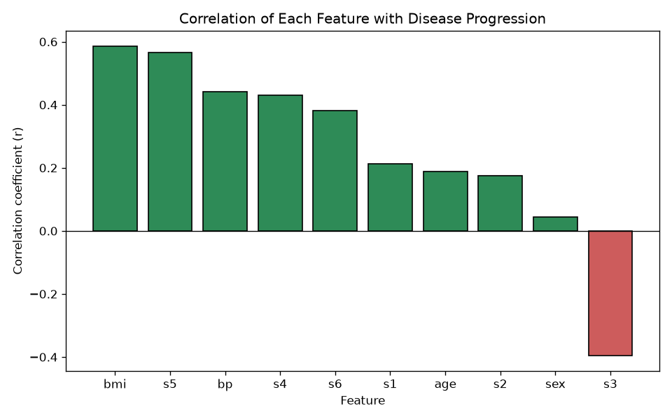
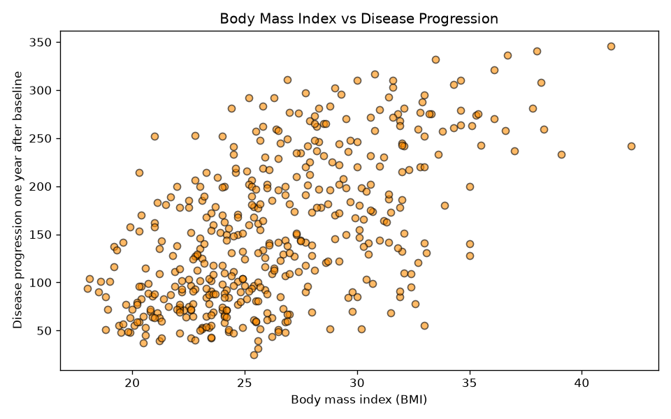
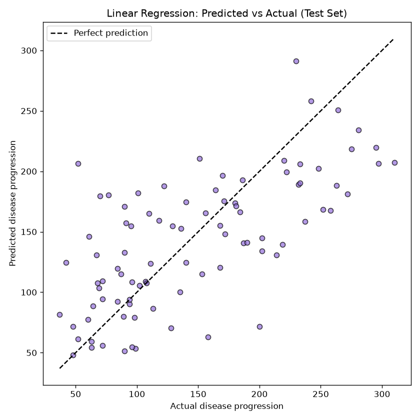
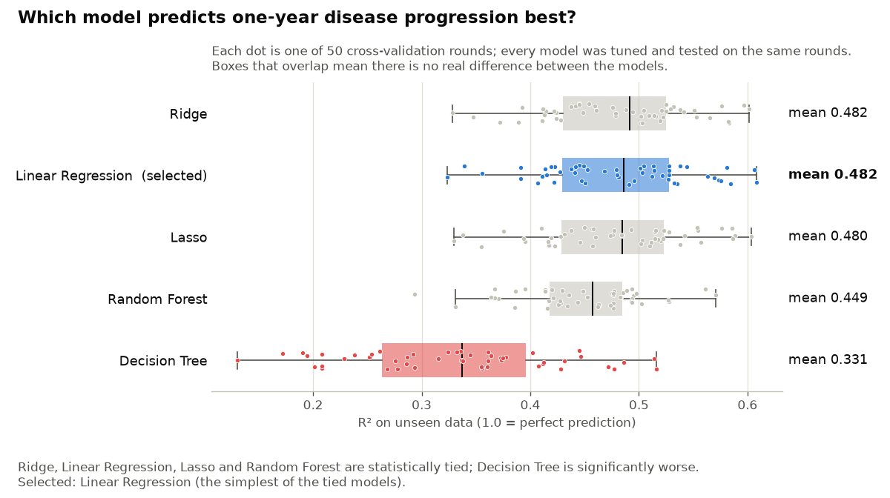
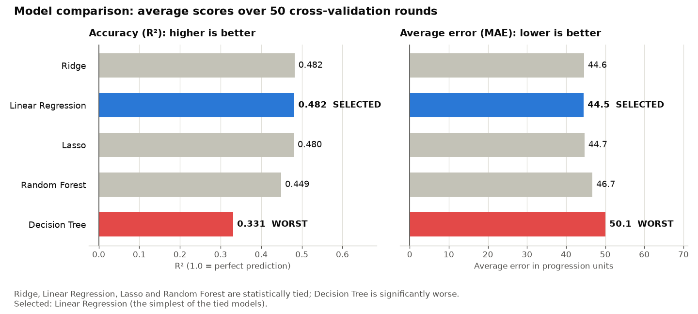
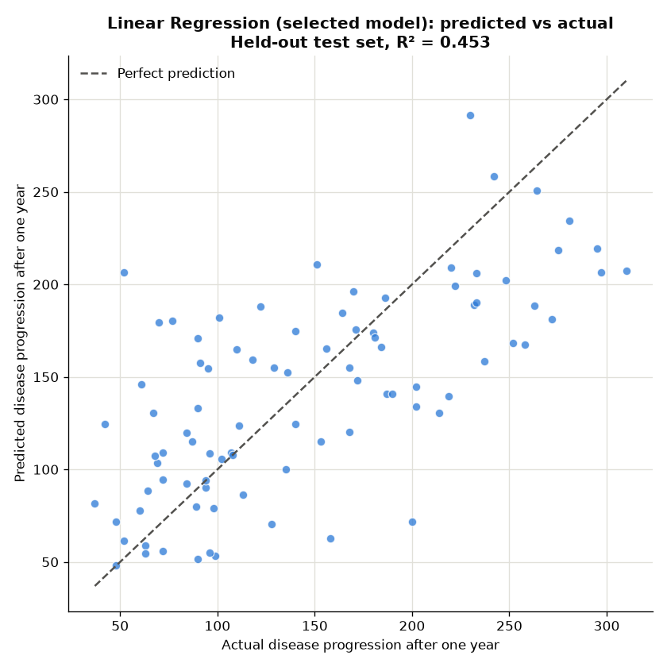

# Predicting Diabetes Disease Progression

**CSCI 6201 — Final Project**

## Team Members

- Zaroon (individual project)

## Dataset

- **Name:** Diabetes dataset (scikit-learn Toy Datasets)
- **Source:** [sklearn.datasets.load_diabetes](https://scikit-learn.org/stable/modules/generated/sklearn.datasets.load_diabetes.html)
- **Samples:** 442 patients
- **Features:** 10 baseline measurements: `age`, `sex`, `bmi`, `bp`, `s1`–`s6` (blood serum measurements)
- **Target:** a number that measures disease progression one year after baseline (range 25–346)
- **Problem type:** **Regression** (the target is a continuous number)

The data is loaded with `load_diabetes(as_frame=True, scaled=False)` so that all values are in their original units (age in years, BMI, blood pressure, ...).

## Research Questions

1. Can the 10 baseline measurements be used to predict a patient's disease progression after one year?
2. Which features appear most related to disease progression?
3. How well does a simple Linear Regression model perform, and can other models improve on it?

## Project Structure

```
├── analysis.py          # Lab 2: exploration + baseline Linear Regression
├── compare_models.py    # Final Project: compare 5 models, select one, export it
├── requirements.txt     # Python libraries needed
├── src/
│   ├── config.py        # Shared settings (paths, random seed, test size)
│   ├── data_loader.py   # Loads the dataset and splits it into X and y
│   ├── explore.py       # Exploratory data analysis
│   ├── visualize.py     # Plots
│   ├── model.py         # Train/test split, Linear Regression, evaluation
│   ├── compare.py       # Tuning, repeated cross-validation, significance test
│   └── export.py        # Saves the selected model as JSON for the web app
├── outputs/
│   ├── figures/         # Saved plots (PNG)
│   ├── results/         # eda_summary.txt, metrics.txt, model_comparison.txt
│   └── model/           # model.json (the selected model)
├── web/                 # Vite + React app that predicts from user input
├── docs/                # Blackboard submission files
└── notebooks/           # For experiments
```

## How to Run

```bash
pip install -r requirements.txt
python analysis.py          # exploration + baseline model (a few seconds)
python compare_models.py    # model comparison + export (about 5 minutes)

cd web                      # the web app
npm install
npm run dev
```

`analysis.py` prints the exploratory analysis and baseline results. `compare_models.py` prints the model comparison, saves figures 05 to 07, and writes the selected model to `outputs/model/model.json` and `web/src/data/model.json`.

## Workflow

```
data -> features (X) and target (y) -> model -> predictions -> evaluation
```

- **X:** the 10 baseline measurements for each patient (the model's inputs)
- **y:** disease progression one year later (what we want to predict)

## Exploratory Analysis: Key Findings

- 442 samples, 10 features, **no missing values**.
- The target ranges from 25 to 346, with a mean of about 152.
- Patients are aged 19–79 (mean about 48.5); BMI ranges from 18.0 to 42.2.
- Correlation with the target is strongest for **BMI (0.59)**, **s5 / log triglycerides (0.57)** and **bp / blood pressure (0.44)**. **s3 / HDL (−0.39)** is the only clear negative relationship. Sex shows almost no correlation (0.04).

Full output: [outputs/results/eda_summary.txt](outputs/results/eda_summary.txt)

## Visualizations

### 1. Distribution of the Target


Disease progression is right-skewed: most patients fall between about 50 and 150, and fewer patients have very high values (above 300). Because there are fewer high-progression examples, the model may be less accurate for those patients.

### 2. Feature Correlations with the Target


BMI and s5 (triglycerides) have the strongest positive relationship with disease progression, followed by blood pressure. s3 (HDL, the "good" cholesterol) is the only feature with a clear negative correlation: higher HDL is linked to lower progression. This chart directly addresses Research Question 2.

### 3. BMI vs Disease Progression


There is a clear upward trend: patients with a higher BMI tend to have a higher disease progression. The points are widely scattered, though, so BMI alone cannot predict progression accurately, which suggests combining several features.

### 4. Predicted vs Actual (Linear Regression)


The points follow the dashed "perfect prediction" line, so the model captures the general trend. However, there is a lot of spread, and the model tends to under-predict patients with very high progression (above 250).

## Preliminary Model Results

**Model:** Linear Regression, 80% training (353 samples) / 20% testing (89 samples), `random_state=42`

| Metric | Value | Meaning |
|---|---|---|
| Mean Squared Error (MSE) | 2900.19 | Average squared prediction error |
| Mean Absolute Error (MAE) | 42.79 | Predictions are off by about 43 units on average |
| R-squared (R²) | 0.453 | The model explains about 45% of the variation in disease progression |

**What this means:** the baseline features *can* partly predict disease progression (Research Question 1), but a simple linear model leaves more than half of the variation unexplained. This gives a baseline to improve on in the Final Project.

Full output: [outputs/results/metrics.txt](outputs/results/metrics.txt)

## Final Project: Which Model Is Best?

Five regression models were compared: Linear Regression, Ridge, Lasso, Decision Tree and Random Forest.

### How the comparison was kept fair

1. **Same data and same splits for every model.** All models are scored on exactly the same train/test rounds.
2. **Every model is tuned.** A grid search picks each model's settings (for example `alpha` for Ridge and Lasso, `max_depth` for the trees). An untuned Decision Tree memorises the training data, so comparing default settings would be unfair.
3. **Repeated nested cross-validation.** 5 folds repeated 10 times gives 50 rounds. In each round the tuning uses the training part only, and the model is scored on data it has never seen. Linear models are scaled inside a pipeline, so the scaler is also fitted on training data only.
4. **Significance test.** The corrected resampled t-test (Nadeau and Bengio, 2003) checks whether a difference between two models is real or just noise from the splits.
5. **Selection rule, fixed in advance.** Take the model with the highest mean R². Any model that is not significantly worse (p ≥ 0.05) counts as tied. Among tied models, choose the simplest.

### Results (50 cross-validation rounds)

| Model | R² (mean ± std) | MAE | RMSE | p vs top | Top model wins |
|---|---|---|---|---|---|
| Ridge | 0.482 ± 0.066 | 44.57 | 54.93 | (top) | |
| **Linear Regression** | **0.482 ± 0.069** | **44.50** | **54.92** | 0.971 | 52% of rounds |
| Lasso | 0.480 ± 0.067 | 44.68 | 55.03 | 0.560 | 54% of rounds |
| Random Forest | 0.449 ± 0.055 | 46.72 | 56.71 | 0.113 | 80% of rounds |
| Decision Tree | 0.331 ± 0.094 | 50.07 | 62.37 | < 0.001 | 100% of rounds |

Confirmation on the held-out test split (80/20, `random_state=42`): Ridge 0.454, Linear Regression 0.453, Lasso 0.456, Random Forest 0.475, Decision Tree 0.295 (R²). The test split has only 89 patients, so these single numbers are less reliable than the 50-round averages.

Full output: [outputs/results/model_comparison.txt](outputs/results/model_comparison.txt)





### Conclusion

- **Linear Regression, Ridge and Lasso perform the same.** Their R² values differ by 0.002, and each one beats the others in about half of the rounds.
- **Random Forest is slightly lower** (R² 0.449). The top model beats it in 80% of the rounds, but the difference is not statistically significant (p = 0.11).
- **Decision Tree is clearly the worst** (R² 0.331, p < 0.001), even after tuning.
- **Selected model: Linear Regression.** It is tied for the best accuracy, has the lowest MAE and RMSE, and is the simplest model with nothing to tune.

No model explains more than about 48% of the variation, so the ten baseline measurements only partly predict disease progression. A typical prediction is off by about 45 points on a scale of 25 to 346.



## Web App

The `web/` folder contains a Vite + React app that asks for the ten measurements and shows the predicted progression after one year, using the selected model.

- Each input has a spinner (− value +) and a slider, limited to the range seen in the dataset.
- The prediction updates live and is shown on a gauge, with the typical error and how the patient compares with the 442 patients in the dataset.
- A chart shows how much each measurement raises or lowers the prediction.
- Three real patients from the dataset can be loaded as examples, together with their recorded progression.

The model is a formula (`prediction = intercept + Σ coefficient × scaled value`), so the app calculates it in the browser from `web/src/data/model.json`. The browser result matches scikit-learn for all 442 patients (largest difference below 1e-12). See [web/README.md](web/README.md).

## Current Progress

- Dataset selected, loaded and explored in Python
- Baseline Linear Regression model trained and evaluated (R² = 0.453 on the test split)
- Five models tuned and compared with repeated nested cross-validation and a significance test
- Linear Regression selected and exported
- Web app built for interactive predictions

## Possible Further Work

- Feature selection (for example, using only BMI, s5 and bp) to see how few measurements are needed
- A residual plot to study where the model makes its largest errors
- Standardised coefficients as a feature-importance chart in the report
