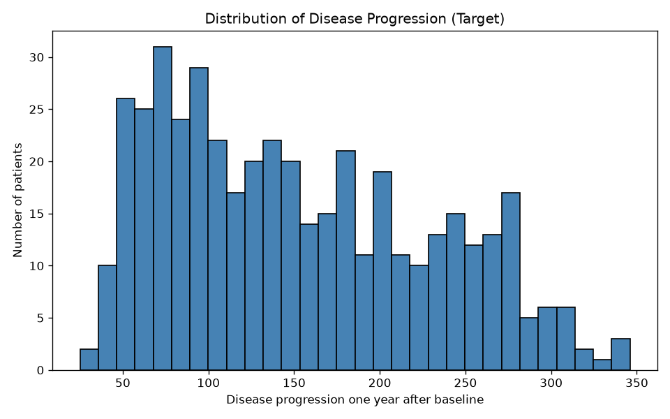
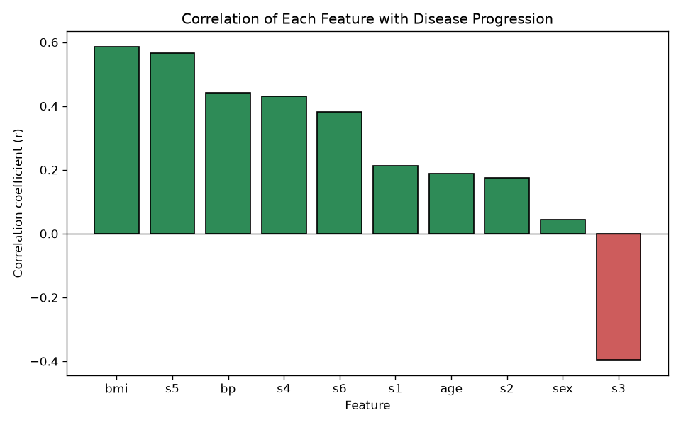
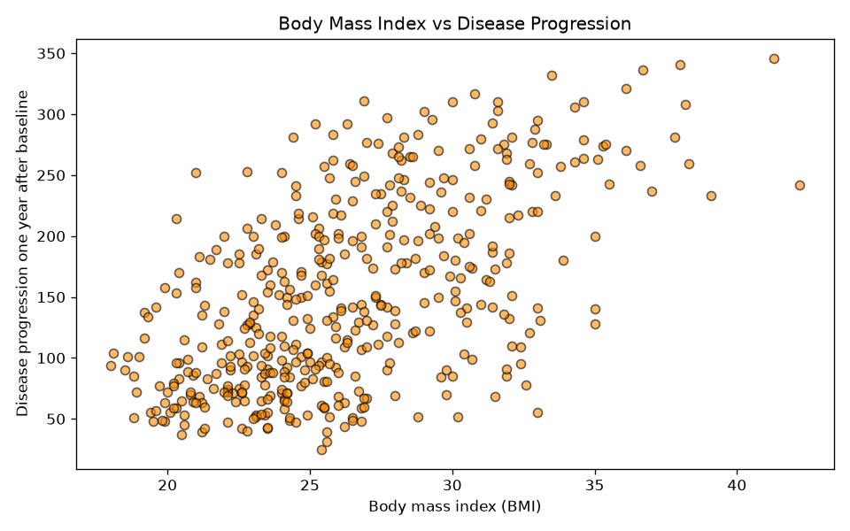
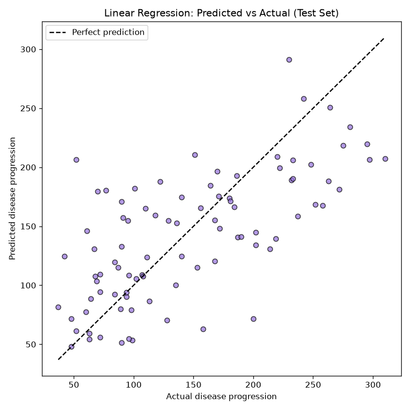

# Predicting Diabetes Disease Progression

**CSCI 6201 — Final Project (Lab 2 Checkpoint)**

## Team Members

- Zaroon (individual project)

## Dataset

- **Name:** Diabetes dataset (scikit-learn Toy Datasets)
- **Source:** [sklearn.datasets.load_diabetes](https://scikit-learn.org/stable/modules/generated/sklearn.datasets.load_diabetes.html)
- **Samples:** 442 patients
- **Features:** 10 baseline measurements: `age`, `sex`, `bmi`, `bp`, `s1`–`s6` (blood serum measurements)
- **Target:** a number that measures disease progression one year after baseline (range 25–346)
- **Problem type:** **Regression** (the target is a continuous number)

The data is loaded with `load_diabetes(as_frame=True, scaled=False)` so that all values are in their original units (age in years, BMI, blood pressure, ...).

## Research Questions

1. Can the 10 baseline measurements be used to predict a patient's disease progression after one year?
2. Which features appear most related to disease progression?
3. How well does a simple Linear Regression model perform, and can other models improve on it?

## Project Structure

```
├── analysis.py          # Main script: runs the full workflow
├── requirements.txt     # Python libraries needed
├── src/
│   ├── config.py        # Shared settings (paths, random seed, test size)
│   ├── data_loader.py   # Loads the dataset and splits it into X and y
│   ├── explore.py       # Exploratory data analysis
│   ├── visualize.py     # Plots
│   └── model.py         # Train/test split, Linear Regression, evaluation
├── outputs/
│   ├── figures/         # Saved plots (PNG)
│   └── results/         # eda_summary.txt and metrics.txt
├── docs/                # Blackboard submission files
└── notebooks/           # For Final Project experiments
```

## How to Run

```bash
pip install -r requirements.txt
python analysis.py
```

The script prints the exploratory analysis and model results, then saves the plots to `outputs/figures/` and the text results to `outputs/results/`.

## Workflow

```
data -> features (X) and target (y) -> model -> predictions -> evaluation
```

- **X:** the 10 baseline measurements for each patient (the model's inputs)
- **y:** disease progression one year later (what we want to predict)

## Exploratory Analysis: Key Findings

- 442 samples, 10 features, **no missing values**.
- The target ranges from 25 to 346, with a mean of about 152.
- Patients are aged 19–79 (mean about 48.5); BMI ranges from 18.0 to 42.2.
- Correlation with the target is strongest for **BMI (0.59)**, **s5 / log triglycerides (0.57)** and **bp / blood pressure (0.44)**. **s3 / HDL (−0.39)** is the only clear negative relationship. Sex shows almost no correlation (0.04).

Full output: [outputs/results/eda_summary.txt](outputs/results/eda_summary.txt)

## Visualizations

### 1. Distribution of the Target


Disease progression is right-skewed: most patients fall between about 50 and 150, and fewer patients have very high values (above 300). Because there are fewer high-progression examples, the model may be less accurate for those patients.

### 2. Feature Correlations with the Target


BMI and s5 (triglycerides) have the strongest positive relationship with disease progression, followed by blood pressure. s3 (HDL, the "good" cholesterol) is the only feature with a clear negative correlation: higher HDL is linked to lower progression. This chart directly addresses Research Question 2.

### 3. BMI vs Disease Progression


There is a clear upward trend: patients with a higher BMI tend to have a higher disease progression. The points are widely scattered, though, so BMI alone cannot predict progression accurately, which suggests combining several features.

### 4. Predicted vs Actual (Linear Regression)


The points follow the dashed "perfect prediction" line, so the model captures the general trend. However, there is a lot of spread, and the model tends to under-predict patients with very high progression (above 250).

## Preliminary Model Results

**Model:** Linear Regression, 80% training (353 samples) / 20% testing (89 samples), `random_state=42`

| Metric | Value | Meaning |
|---|---|---|
| Mean Squared Error (MSE) | 2900.19 | Average squared prediction error |
| Mean Absolute Error (MAE) | 42.79 | Predictions are off by about 43 units on average |
| R-squared (R²) | 0.453 | The model explains about 45% of the variation in disease progression |

**What this means:** the baseline features *can* partly predict disease progression (Research Question 1), but a simple linear model leaves more than half of the variation unexplained. This gives a baseline to improve on in the Final Project.

Full output: [outputs/results/metrics.txt](outputs/results/metrics.txt)

## Current Progress

- Dataset selected, loaded and explored in Python
- Four visualizations created and interpreted
- Baseline Linear Regression model trained and evaluated (R² = 0.453)
- Project structured into reusable modules for the Final Project

## Next Steps for Final Project

**What is working so far?**
The full workflow runs from start to finish with one command: loading, exploration, visualizations, model training and evaluation. The baseline model explains about 45% of the variation in the target.

**What part of the project still needs work?**
The results come from a single train/test split, so they may change with a different split. Also, the coefficients cannot be compared directly yet, because the features are in different units.

**What do I plan to add or improve before the Final Project?**
- Use cross-validation for more reliable performance estimates
- Compare other models: Ridge, Lasso, Decision Tree, Random Forest
- Scale the features so coefficients can be compared to measure feature importance
- Try feature selection (for example, using only the strongest features such as BMI, s5 and bp)
- Add a residual plot to study where the model makes its largest errors

**Is there anything I would specifically like instructor feedback on?**
- I am currently working individually. Is that approved, or should I join a team for the Final Project?
- Are my research questions focused enough, or should I narrow them down?
- Would comparing several regression models be an appropriate scope for the Final Project?
